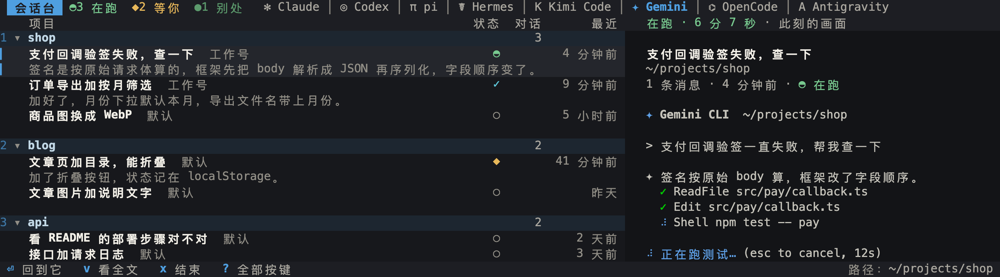

<div align="center">

# huitai `ai`

Type `ai` in your terminal to see every Claude Code, Codex, pi, Hermes, Kimi Code, Gemini CLI, OpenCode and Qwen Code conversation on this Mac, grouped by project. Press Enter to pick one back up. Close the window and it keeps running in the background.

[](https://github.com/dodo258/huitai/releases/latest) [](LICENSE)  

**[Website](https://huitai.agentq.cc/en/)** &nbsp;·&nbsp; **[Install](#install)** &nbsp;·&nbsp; **[Everyday tasks](#everyday-tasks)** &nbsp;·&nbsp; **[Keys](#keys)** &nbsp;·&nbsp; **[Privacy](#privacy)** &nbsp;·&nbsp; [简体中文](README.md) · **English**

<br>

<picture>
  <source media="(prefers-color-scheme: light)" srcset="docs/images/board-light.png">
  
</picture>

<sub>Screenshots use made-up data.</sub>

</div>

## What it is

A command-line tool that lives in your terminal. It is not a terminal and it does not use tmux. You keep your own terminal (Ghostty, Kaku, cmux or anything else); huitai does three things:

- **Find**: conversations from every tool in one place, grouped by project, newest first, with search over titles and message text.
- **Resume**: Enter opens the conversation in a new tab in its project directory; if it is already open, that tab comes to the front.
- **Keep running**: conversations run inside huitai's own background daemon, so closing the tab or the whole terminal does not stop them. Press Enter later and the screen and history are still there. After a power cut, the interrupted ones are listed and can all be resumed with one key.

huitai passes your keys and the CLI's output through untouched: pasting images, dropping files, `Shift+Enter` for a new line and input methods behave exactly as with the bare CLI.

The interface is in Simplified Chinese.

## Install

```sh
curl -fsSL https://github.com/dodo258/huitai/releases/latest/download/install.sh | sh
```

The script downloads the prebuilt `ai` for your chip (Apple silicon or Intel), checks its SHA256 and puts it in `~/.local/bin`. No sudo. Upgrade later with `ai update`.

Or build from source (needs a recent stable Rust, `rustup update stable`):

```sh
cargo install --locked --git https://github.com/dodo258/huitai
```

**Requirements**: macOS (developed and tested on macOS 27 with Apple silicon; the Intel build is compiled but not tested on real hardware). Opening conversations in a new tab needs [Ghostty](https://ghostty.org) 1.3 or later, [Kaku](https://github.com/tw93/Kaku) or [cmux](https://cmux.com); other terminals open them in the current window (cmux does not support opening at login or ⌥Space opening a new board, because it refuses control from outside). Whichever of Claude Code, Codex, pi, Hermes, Kimi Code, Gemini CLI, OpenCode and Qwen Code you have installed shows up. The CLIs can live anywhere on your PATH, and if you moved their data with `CLAUDE_CONFIG_DIR`, `CODEX_HOME` or `PI_CODING_AGENT_DIR`, huitai looks there too.

**Footprint**: about 27 MB of memory while the list is open and about 22 MB for the idle background daemon (measured on an Apple M4 Max); when nothing is running it does not redraw and uses almost no CPU.

## Get started in three steps

1. **Install**: see above.
2. **Type `ai`**: the tools you have installed sit along the top as tabs (missing ones are hidden); click one or press `Tab` to switch. Conversations are grouped by project on the left; the last few messages are previewed on the right, and `v` shows the whole conversation.
3. **Press Enter to continue**: select a conversation and press Enter. A new tab opens in the project directory and resumes it.

Not sure everything is set up? Run `ai doctor`. It checks the three CLIs and their versions, the session directories, quota, whether the current terminal can open new tabs, and whether the background daemon is running.

## Everyday tasks

**Find a conversation**: `Tab` switches tool, `↑↓` or `jk` moves, `←→` collapses or expands a project, Enter on a project goes straight to its first conversation, `1-9` jumps to a project. `/` searches titles and message text.

**Continue a conversation**: Enter opens it in a new tab; if it is already open, that tab comes to the front instead of a second one. Press `w` to chat in the current window; when the conversation ends you are back in the list.

**New or existing projects**: `n` starts a new conversation in the selected project. `m` starts one in another directory, with `Tab` completion; a bare name is created under `~/projects`, and you are asked before a missing directory is created. On a project, `o` opens it in your editor, `f` shows it in Finder, `g` lists changed files.

**Close the window, keep the work**: conversations run inside huitai's background daemon. Close the tab, or the whole terminal, and they keep working. Come back, select one and press Enter: the screen and history are still there. A conversation nobody is watching that has been waiting for you for 30 minutes has its process stopped; the record stays and Enter picks it up again. Change the time in settings (`,`).

**Pick up after a power cut**: after a power cut, reboot or daemon crash, open `ai` and an "Interrupted" group appears at the top with the conversations that were running. `R` reopens all of them in new tabs and tells each one to check where it left off before carrying on; to open just one, select it and press Enter. Settings has an option to open huitai at login.

**Check your quota**: the right side of the top bar shows the current tool's quota. Claude and Codex show how much of each limit window (such as 5 hours and 7 days) is used, pi shows tokens used today, followed by where the number came from and when. When it can't be read, `ai doctor` shows where each source failed.

**Get deleted conversations back**: `d` moves a conversation to huitai's trash; nothing is really deleted (Codex conversations are only hidden). `u` restores the most recently deleted one for this tool; press it again to go further back.

A header row tops the list: projects on the left, then columns for status, background conversations running, number of conversations, and when you last talked. Keys 1–9 jump to a project. Expanded project headers sit on a tinted band, and when you scroll into a long group its header stays pinned at the top, so you can always click it or press `←` to fold it. Projects you have not touched for a month fold into "long idle" at the bottom; press Enter to open it. The path at the bottom right opens in Finder when clicked.

Status lights in the list: a spinning green half-circle `◐` is running, `◆` is waiting for you (slowly blinking), `✓` just finished, `○` stopped. The moment a conversation stops running (done, or waiting for you) its whole row lights up and fades out over a couple of seconds; a collapsed project lights its header instead. Pale green means the conversation is open somewhere else (the desktop app, say): spinning while it works, still while it is just open; you are asked before opening it.

Right after the seal, the top bar totals every tool: conversations huitai hosts that are running (`◐3 在跑`) or waiting for you (`◆1 等你`), and conversations open elsewhere (`●2 别处`); zeros are left out. Click the waiting count to jump to the next one waiting for you, or the elsewhere count to jump to the next one open elsewhere.

## Tips

- Type `ai` inside a project directory (or any subdirectory) and that project opens expanded.
- `!` jumps to the next conversation waiting for you, across every tool; clicking `◆` in the top bar does the same. Clicking `●N 别处` in the top bar jumps to the next one open elsewhere, such as the desktop app.
- `s` lists every conversation waiting for you or running, across every tool, with the waiting ones first, so you can see at a glance which ones are stuck; `Esc` goes back to the list.
- `v` (or `→`) shows the whole conversation, read-only: it starts at the end, tool calls are folded into one line (`t` unfolds them), and when opened from search results the search words are highlighted and `n` jumps to the next one. Once you are sure it is the right one, `⏎` continues it.
- `⌥Space` brings up huitai from anywhere. It works once the daemon is up, which happens the first time you open a conversation.
- `c` copies the resume command (`cd 'dir' && claude --resume …`); paste it into any terminal to continue.
- `x` ends a conversation running in the background.
- Pasting images (`Ctrl+V`), dragging files into the window and `Shift+Enter` for a new line work in chat tabs exactly as with the bare CLI: huitai does not sit in between rewriting your keys.
- Single-key shortcuts work with a Chinese input method on: huitai switches to an English layout while it is in front and switches back when you leave; typing Chinese starts a search.
- Conversations run by scripts are hidden by default; the "后台" (background) column shows how many are running in each project, and `b` shows them.
- Right-click a conversation or project to see everything you can do with it.
- `e` on a project gives it a display name, used in the list and in tab titles; the folder is not renamed.
- `p` pins a conversation you use often, `a` archives one you no longer want to see; `a` on a project archives the whole group.
- Tab titles start with the tool mark and project name (`✻ shop · …`), so a row of tabs stays readable.

## Privacy

- Reads the three tools' session files on this Mac and never changes their configuration (`~/.claude/settings.json`, `~/.codex/config.toml`, `~/.pi/agent/`). The only thing that moves their files is delete, which goes to huitai's trash and can be undone.
- No uploads, no analytics, no telemetry. Renames, pins, archives and settings live in `~/Library/Application Support/huitai/`.
- When huitai starts Claude it passes `--settings` with a status line command to read quota. It applies to that launch only, and your own status line still shows.
- There are only two kinds of network access. The first is Claude's fallback quota source: when the status line data is missing, it asks Anthropic's official usage endpoint once using your local Claude Code login, and caches the answer for 5 minutes. The credential is used in memory only, never written to disk. `ai doctor` tries every source, so it makes this request too.
- The second is the new-version check: at most once a day it sends one request to GitHub Releases with no personal information, gives up silently after 3 seconds, and when a newer version exists the top bar shows "有新版 x.y.z · ai update" (new version available). It never updates by itself. To turn it off, switch off 「检查新版本」 (check for new versions) in settings (`,`), or set the environment variable `HUITAI_NO_UPDATE_CHECK=1`.

## Keys

Every action is a single key. The bottom bar shows the most common ones; `?` shows them all. The mouse works too: click to select, double-click to open, right-click for actions, scroll to move.

| Group | Key | Action |
|---|---|---|
| Find | `Tab` / `⇧Tab` | Switch tool |
| | `↑↓` `jk` | Move |
| | `←→` `hl` | Collapse / expand |
| | `/` | Search titles and text |
| | `1-9` | Jump to a project |
| | `!` | Next conversation waiting for you (any tool) |
| | `s` | Everything waiting for you or running, every tool in one list |
| | `v` / `→` | Read the whole conversation (`t` unfolds tool calls) |
| | `b` | Show / hide background conversations |
| Open | `⏎` | Open in a new tab |
| | `w` / `⌥⏎` | Open in the current window (`⌥⏎` needs Option as Alt) |
| | `n` | New conversation in this project |
| | `m` | New project, or a conversation in another directory (`Tab` completes) |
| | `R` | Resume everything interrupted; otherwise reopen last session's tabs |
| | `c` | Copy the resume command |
| Organize | `e` | Rename (on a project: display name) |
| | `p` | Pin / unpin |
| | `a` | Archive / unarchive (on a project: whole group) |
| | `d` | Move to trash |
| | `u` | Restore from trash |
| | `x` | End a background conversation / dismiss from Interrupted |
| Project | `o` | Open in editor |
| | `f` | Show in Finder |
| | `g` | Show changed files |
| Other | `,` | Settings |
| | `?` | All keys |
| | `q` | Quit (background conversations keep running) |
| Global | `⌥Space` | Bring up huitai |

There are five commands: `ai` (the list), `ai doctor` (self-check), `ai update` (upgrade: runs `brew upgrade` for Homebrew installs, prints the command for cargo installs, and for downloaded builds verifies the new one before swapping it in; running conversations are not interrupted), `ai attach <id>` (used by new tabs, no need to remember it) and `ai daemon` (the background daemon, started automatically).


## How it differs from Rex

[Rex](https://www.superlogical.com/) is a terminal from Superlogical, the company started by Ghostty's author; its macOS app entered public testing in October 2026. Both keep AI conversations running after you close the window and show which one is waiting for you; they differ in the ways below:

| | huitai | Rex |
|---|---|---|
| What it is | One command, `ai`, inside the terminal you already use (Ghostty, Kaku, cmux, others) | A standalone terminal app that replaces your current terminal |
| Which conversations | Every past Claude Code, Codex, pi, Hermes, Kimi Code, Gemini CLI, OpenCode and Qwen Code conversation on this Mac, grouped by project, full-text searchable, resumed with Enter | Sessions opened in Rex; shows which Claude Code, Codex, OpenCode or pi session is working or waiting for you |
| Quota | Top bar shows Claude and Codex limit windows and pi's tokens today | Not mentioned in the official material |
| Several machines | This Mac only | Its strength: connect to Rex servers on other machines; iOS and other clients are on the way |
| Getting it | One-line install, MIT licensed | Join the mailing list and wait for an invite; free, no account needed |

Pick Rex if you want a more capable terminal and to carry work between machines. Pick huitai if you want to keep your terminal and find, resume and keep alive the AI conversations scattered across your Mac. huitai does not mind which terminal it runs in: in terminals outside its new-tab list, Rex included, conversations open in the current window (not yet tried inside Rex).

<sub>Rex details come from its [website](https://www.superlogical.com/), [public testing announcement](https://www.superlogical.com/updates/public-testing-beginning) and [CLI docs](https://www.superlogical.com/rex/docs/automate/cli), as of November 2026. It is still in testing; check the official pages for current details.</sub>

## Contributing

Report problems and ideas as [issues](https://github.com/dodo258/huitai/issues). Before changing code, read [CONTRIBUTING.md](CONTRIBUTING.md) for the module layout and how to run the checks. For security issues see [SECURITY.md](SECURITY.md).

## License

[MIT](LICENSE)
