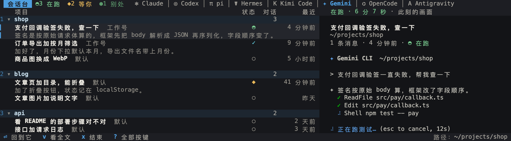

<div align="center">

# 会话台 `ai`

在终端里敲 `ai`，本机 Claude Code、Codex、pi、Hermes、Kimi Code、Gemini CLI、OpenCode、Antigravity 的所有对话按项目列出来，回车接着聊；关掉窗口，对话照样在后台跑。

[](https://github.com/dodo258/huitai/releases/latest) [](LICENSE)  

**[官网](https://huitai.agentq.cc)** &nbsp;·&nbsp; **[安装](#安装)** &nbsp;·&nbsp; **[常用操作](#常用操作)** &nbsp;·&nbsp; **[快捷键](#快捷键)** &nbsp;·&nbsp; **[隐私](#隐私)** &nbsp;·&nbsp; **简体中文** · [English](README.en.md)

<br>

<picture>
  <source media="(prefers-color-scheme: light)" srcset="docs/images/board-light.png">
  
</picture>

<sub>截图用的是假数据。</sub>

</div>

## 它是什么

一个装在终端里的命令行工具，不是终端，也不用 tmux。你照样用自己的终端（Ghostty、Kaku、cmux 或别的），会话台只负责三件事：

- **找得到**：各家的对话放在一起，按项目分组、按时间排，标题和正文都能搜。
- **接得上**：回车在新标签页里进到项目目录接着聊；已经开着的直接切过去，不开第二个。
- **断不了**：对话跑在会话台自己的后台里，关掉标签页甚至整个终端，它照样干活；回来回车，画面和历史都在。断电重启后列出被中断的，一键全部接着做。

会话台夹在中间时不改你的按键和输出：贴图、拖文件、`Shift+Enter` 换行、中文输入法，在聊天标签页里和直接跑 CLI 完全一样。

## 安装

```sh
curl -fsSL https://github.com/dodo258/huitai/releases/latest/download/install.sh | sh
```

脚本按芯片（Apple 芯片或 Intel）下载预编译的 `ai`，SHA256 对上才放进 `~/.local/bin`，不用 sudo。以后升级跑 `ai update`。

也可以从源码装（要最新的 stable Rust，`rustup update stable`）：

```sh
cargo install --locked --git https://github.com/dodo258/huitai
```

**要求**：macOS（在 macOS 27、Apple 芯片上开发和测试；Intel 版只做了构建，没有真机测过）。在新标签页打开对话需要 [Ghostty](https://ghostty.org) 1.3 以上、[Kaku](https://github.com/tw93/Kaku) 或 [cmux](https://cmux.com)，别的终端在当前窗口打开（cmux 不支持开机自动打开和 ⌥空格新开会话台，它不接受从外面控制）。Claude Code、Codex、pi、Hermes、Kimi Code、Gemini CLI、OpenCode 装了哪家就列哪家：CLI 装在哪都行，你的终端里敲得出来就行；用 `CLAUDE_CONFIG_DIR`、`CODEX_HOME`、`PI_CODING_AGENT_DIR` 把数据放在别处的，会话台跟着去那里找。界面是简体中文。

**占用**：会话台开着时约 27 MB 内存，后台守护进程空闲时约 22 MB（Apple M4 Max 实测）；没东西在跑时不重画，几乎不占 CPU。

## 三步上手

1. **安装**：见上面。
2. **敲 `ai`**：顶上一排标签是你装了的那几家（没装的不显示），单击或按 `Tab` 切换；左边按项目分组列对话，右边预览最后几条消息，按 `v` 看整段对话。
3. **回车接着聊**：选中一条按回车，新标签页里进到项目目录，接着这条对话聊。

拿不准装好没有，跑 `ai doctor`：它会查各家 CLI 是怎么装的（npm、Homebrew、官方安装脚本……）、当前版本、最新版、该用哪条命令升级，还有会话目录、额度、当前终端能不能开新标签页、后台在不在。

## 常用操作

**找对话**：`Tab` 换一家，`↑↓` 或 `jk` 移动，`←→` 收起、展开项目，在项目上按回车直接进到它的第一条对话，`1-9` 跳到第几个项目。`/` 搜标题和对话正文，默认只搜当前这家；不记得是在哪家聊的，搜索时按 `⌃A` 各家一起搜（结果按相关度混排，每行前面标那家的标记，回车照常打开），再按一次或 `Tab` 换家回到只搜一家。

**接着聊**：回车在新标签页打开，已经开着的直接切过去，不会开第二个。想在当前窗口聊就按 `w`，对话结束回到会话台；聊到一半想回会话台按 `⌃\`（接上时底栏会提示一秒），对话留在后台接着跑，之后回车或 `w` 接回去。在新标签页里按 `⌃\` 也一样脱开，对话不停，标签页跟着关掉。粘贴的内容里带这个字符不算。这个键在设置（`,`）的「回会话台」里可以换成 `⌃Q`、`⌃]` 或关掉；默认用 `⌃\` 是因为支持的几家 CLI 都没占它，`⌃Q` 在 Hermes、Kimi Code、Qwen Code 里有用，`⌃]` 在 Codex、pi 里有用，换成它们那一家里这个键就到不了 CLI。

**新建、打开项目**：`n` 在选中的项目里开一条新对话。`m` 新建项目或换个目录新建，`Tab` 补全目录；只输一个名字就建在 `~/projects` 下，目录不存在会先问你再建。项目上按 `o` 用编辑器打开，`f` 在 Finder 里显示，`g` 看改了哪些文件。

**关窗口任务不停**：对话跑在会话台的后台里，关掉标签页甚至整个终端，它照样干活。回来选中它按回车，画面和历史都在。没人看、等你回复超过 30 分钟的对话，后台会收掉进程，记录还在，回车照样接着聊；时长在设置（`,`）里改。

**断电后接着做**：断电、重启或者后台崩了，再打开 `ai`，最上面多一组「被中断」，列出当时在跑的对话。按 `R` 全部在新标签页重开，并让它们先检查现场再接着做；只想打开一条，选中按回车。设置里可以打开「开机自动打开会话台」。

**看额度**：顶栏右边是当前这家的额度。Claude、Codex 显示各个限额窗口（比如 5 小时、7 天）用了多少、多久后重置，pi 显示今天用了多少 token，后面跟着从哪读的、什么时候读的。读不到时，`ai doctor` 会列出每个渠道卡在哪。

**看上下文用了多少**：会话台里开的 Claude 对话，列表那行和预览区标题后面写「上下文 72%」，80% 起变黄、95% 起变红，提醒你该 `/compact` 或开新对话。数来自 Claude 给状态栏的官方数据，回复一次才有；别的家暂时没有。

**删了能找回**：`d` 把对话移进会话台的回收站，不真删（Codex 的对话只是藏起来）。`u` 恢复这家最近删的一条，多按几次依次往前找回。

**Claude 删旧对话前有提醒、有备份**：Claude Code 会删掉超过 `cleanupPeriodDays`（默认 30 天）没动的对话。离删除不到 3 天的，预览区标题后写「约 2 天后被 Claude 删除」；`ai doctor` 写明你这台机器上是多少天。置顶、改名、归档过的 Claude 对话会话台自动压缩备份（设置里可改成备份全部），存在 `~/Library/Application Support/huitai/backups/claude/`。Claude 删了原文件之后，列表里照常有这条，标「只剩备份」，能预览、看整段、搜索、导出；要接着聊就按 `P`（或右键菜单「放回 Claude 目录再接着聊」）把它放回原处，原处已有同名文件不覆盖。

列表顶上一行表头：左边是项目和对话标题，右边几列依次是状态（每条对话的状态灯，有计划时前面写进度如 `2/5`；收起的项目写组里几条在跑、有没有等你）、后台在跑几条、对话条数、最近什么时候聊过。每列都靠右对齐在表头字下面；终端窄了先省对话条数，再省后台、最近，表头跟着一起省，状态列一直在。数字 1–9 跳到对应项目。展开着的项目标题垫一层淡底，往下翻到组中间时它钉在列表最上面，随时点一下、按 `←` 就能收起。一个月以上没聊过的项目收进列表底部的「很久没聊」，回车打开。底栏右侧是选中项目的路径，单击在访达里打开。

列表里的状态灯（在状态列）：转着的绿色半圆 `◐` 在跑，`◆` 等你回复（慢慢闪），`✓` 刚做完、你还没看过（看过就变成 `◆`），`✗` 失败，`○` 已停；要你处理的三种在符号后补个短词：`◆ 等回复`、`✓ 待读`、`✗ 失败`，扫一眼状态列就知道哪条该回一句、哪条看一眼结果（终端窄到标题放不下时只留符号）；一条对话从在跑停下来（做完或要你回复）的那一刻，整行亮一下再慢慢淡掉，收起的项目组由组标题替它亮；淡绿色的是别处（比如桌面端）开着的对话，转着表示它正在干活、不转表示只是开着，打开前会先问你。

顶栏印章后面是各家合计：会话台托管的在跑几条（`◐3 在跑`）、待处理几条（`◆1 待处理`，等回复、待读、失败都算），别处开着几条（`●2 别处`）；没有就不写。单击「待处理」跳到下一条待处理的，单击「别处」跳到下一条别处开着的。

## 使用技巧

- 在项目目录（或它的子目录）里敲 `ai`，这个项目自动展开。
- `!` 跳到下一条待处理的对话，各家轮着找；点顶栏的 `◆` 也一样。点顶栏的 `●N 别处` 跳到下一条桌面端等别处开着的。
- `s` 把各家待处理和在跑的对话列在一起，等回复的排最前，其次失败、待读，一眼看出哪几条卡着；`Esc` 回到列表。
- `v`（或 `→`）看整段对话：只读，从最后看起，工具调用折成一行、`t` 展开；从搜索结果里打开会高亮搜索词，`n` 跳下一处。确认是这条再 `⏎` 接着聊。按 `s` 把这条对话存成 Markdown，放在 `~/Downloads/<标题>-<日期>.md`（重名加序号），底栏写存到哪了；文件开头是标题、厂商、项目、时间，每条消息标着是你还是 AI，工具调用每次一行。
- `⌥空格` 随时呼出会话台。后台第一次开对话时起来，之后一直有效。
- `c` 复制恢复命令（`cd '目录' && claude --resume …`），粘进任何终端都能接着聊。
- `x` 结束一条在后台跑的对话。
- 贴图（`Ctrl+V`）、把文件拖进窗口、`Shift+Enter` 换行，在聊天标签页里和直接跑 CLI 一样用：会话台不夹在中间改你的按键。
- 开着中文输入法也能直接按单键：会话台在前台时自动切成英文，离开切回；打出中文就直接开始搜索。
- 脚本自动跑的对话默认藏起来，表头「后台」那一列写着每个项目有几条在跑，按 `b` 显示。
- 右键一条对话或一个项目，看它能做的所有操作。
- 项目上按 `e` 起个显示名，列表和标签页标题都用它，不改文件夹名。
- `p` 置顶常用的对话，`a` 归档不想再看到的；项目上按 `a` 整组归档。
- 怕撞额度停在半路：在 Claude 或 Codex 的对话上按 `A`（或右键「撞额度后到点自动继续」）。它撞了上限、停着等你的话，到重置时间过 1 分钟，会话台像 `R` 一样在新标签页带一句「继续」接着做，每次上限只发一次，这一行标「已自动继续」。认撞上限读的是 CLI 写进会话记录的那条，不看屏幕；会话台要开着。
- 标签页标题前面带着厂商标记和项目名（`✻ shop · …`），开了一排也认得出哪个是哪个。

## 隐私

- 只读本机各家的会话文件，不改它们的配置（`~/.claude/settings.json`、`~/.codex/config.toml`、`~/.pi/agent/`）。唯一会动厂商文件的是删除：移进会话台回收站，能恢复；唯一会往厂商目录写的是你按 `P` 把只剩备份的 Claude 对话放回原处。
- 不上传对话，没有统计和遥测。改名、置顶、归档、设置都存在本机 `~/Library/Application Support/huitai/`。
- 会话台启动 Claude 时用 `--settings` 加一个状态栏命令来读额度，只对这次启动有效，你原来的状态栏照常显示。
- 联网只有这几处。一是 Claude 额度的备用渠道：状态栏的数据读不到时，用本机 Claude Code 的登录凭证问一次 Anthropic 官方用量接口，结果缓存 5 分钟；凭证只在内存里用，不存盘。`ai doctor` 会把每个渠道都试一遍，也会问这一次。
- 二是查新版本：每天最多一次，向 GitHub Releases 发一个不带任何个人信息的请求，3 秒没回就算了，不提示。有新版时顶栏右边多一句「有新版 x.y.z · ai update」，不会自己更新。不想让它查：设置（`,`）里关掉「检查新版本」，或者设环境变量 `HUITAI_NO_UPDATE_CHECK=1`。
- 三是查各家 CLI 的新版：按本机的装法问对应的公开接口（npm 装的问 npm registry，Homebrew 装的问 formulae.brew.sh，官方安装器装的问它自己的发布地址，Codex 独立安装和 Hermes 问 GitHub），每家 20 小时最多一次，10 秒没回就算了，不带任何个人信息。有新版时顶栏那家标签后多一个「↑」，`ai doctor` 写出新版本和升级命令。和上一条用同一个开关关掉。
- 升级各家 CLI：能替你升的，顶栏右边出现带底色的「更新」，按 `U` 或点一下就按本机装法跑那家的官方升级命令（`npm install -g …@latest`、`brew upgrade …`、官方安装脚本、`claude update` 这类，不用 sudo），升级中显示「更新中 1/2」，都成了按钮自己消失，没升上的变成「1 家没升上」，点开看命令和原文。命令行是 `ai update <家>`、`ai update --all`。设置里「自动升级」默认开：那家没有会话台托管的对话在跑时自动升，不跨大版本；Claude、Kimi Code 这类自带自动更新的先让它自己装，新版出来 24 小时本机还是旧版才替它升。装在要 sudo 的目录、npm 前缀对不上、跨大版本的只给命令，不替你跑。结果在状态栏说一句，`ai doctor` 里看上次升级。

## 快捷键

全部是单键，底栏常驻最常用的几个，按 `?` 看全部。鼠标也能用：单击选中，双击打开，右键看操作，滚轮移动。

| 分类 | 按键 | 作用 |
|---|---|---|
| 找 | `Tab` / `⇧Tab` | 换一家 |
| | `↑↓` `jk` | 移动 |
| | `←→` `hl` | 收起 / 展开 |
| | `/` | 搜标题和正文 |
| | `⌃A`（搜索时） | 各家一起搜 / 只搜当前这家 |
| | `1-9` | 跳到第几个项目 |
| | `!` | 下一条待处理的（跨家） |
| | `s` | 各家待处理和在跑的列在一起 |
| | `v` / `→` | 看整段对话（只读，`t` 展开工具调用，`s` 存成 Markdown） |
| | `b` | 显示 / 隐藏后台对话 |
| 开 | `⏎` | 新标签页打开 |
| | `w` / `⌥⏎` | 当前窗口打开（`⌥⏎` 要终端把 Option 当 Alt） |
| | `⌃\`（对话里） | 回到会话台，对话在后台继续（设置里可换 `⌃Q`、`⌃]` 或关掉） |
| | `n` | 在这个项目开新对话 |
| | `m` | 新建项目，或在别的目录开对话（`Tab` 补全） |
| | `R` | 被中断的全部接着做；没有被中断的就恢复上次所有标签 |
| | `c` | 复制恢复命令 |
| 整理 | `e` | 改名（项目上改显示名） |
| | `p` | 置顶 / 取消 |
| | `a` | 归档 / 取消（项目上整组） |
| | `A` | 撞额度后到重置时间自动继续 / 取消（Claude、Codex 的对话） |
| | `d` | 进回收站 |
| | `u` | 从回收站恢复 |
| | `P` | 只剩备份的 Claude 对话放回原处 |
| | `x` | 结束后台对话 / 移出被中断 |
| 项目 | `o` | 用编辑器打开 |
| | `f` | 在 Finder 显示 |
| | `g` | 看改了哪些文件 |
| 其他 | `,` | 设置 |
| | `U` | 升级各家 CLI（顶栏有「更新」时；有没升上的就看原文） |
| | `?` | 全部按键 |
| | `q` | 退出（后台对话不停） |
| 全局 | `⌥空格` | 呼出会话台 |

命令行只有八个：`ai`（会话台）、`ai doctor`（自检）、`ai list`、`ai search <词>`（不进界面直接列对话、搜对话，见下面「命令行查询」）、`ai export <对话 id> [-o 文件]`（把一条对话导出成 Markdown，不给 `-o` 就打到标准输出；对话 id 在 `c` 复制的恢复命令里，几个账号里都有同一个 id 时会列出带账号的写法让你选）、`ai update`（升级会话台自己：Homebrew 装的跑 `brew upgrade`，cargo 装的告诉你命令，直接下载的校验后换成新版；在跑的对话不受影响；`ai update <家>` 升级那家 CLI，`ai update --all` 升级全部能升的）、`ai attach <id>`（新标签页里用的，不用记）、`ai daemon`（后台，自动拉起）。

## 命令行查询

不进界面、直接把结果打出来，可以接管道、给脚本用。只读：读的是会话台上次扫到的索引，不扫描、不改任何文件，也不拉起后台；刚聊的新对话要开一次 `ai` 才查得到。从没开过 `ai`（还没有索引）时会说「还没有索引……先运行一次 ai」并以非 0 退出。

- `ai list [--vendor 名] [--json]`：列出全部对话，最近的在前。`--vendor` 只要一家，写 `claude`、`codex`、`pi`、`hermes`、`kimi`、`gemini`、`opencode`、`antigravity` 或顶栏上的名字（不分大小写）。
- `ai search <词…> [--json]`：搜标题和正文，结果和顺序同界面里按 `/` 搜：一家一家排（顺序同顶栏），每家里标题命中的在前、之后正文按相关度。几个词用空格分开，每个都要命中。

不加 `--json` 时一条一行、各列对齐：时间、厂商、账号、状态（`托管中` 或 `-`）、项目、标题、id。id 在最后，`ai list | awk '{print $NF}'` 就能拿到；项目、标题太长会截断。`ai search` 正文命中的结果，下一行缩进四格写命中的那段正文。没有结果时什么都不打，在标准错误说一句。

加 `--json` 打一个 JSON 数组，没有结果是 `[]`。每条的字段是稳定接口，以后只加不改：

| 字段 | 类型 | 含义 |
|---|---|---|
| `id` | 字符串 | 会话台用的对话 id，`ai export <id>` 认它；非默认账号的带 `<账号>:` 前缀 |
| `vendor` | 字符串 | 厂商：`claude`、`codex`、`pi`、`hermes`、`kimi`、`gemini`、`opencode`、`antigravity` |
| `account` | 字符串 | 账号显示名，家目录下默认位置的叫「默认」 |
| `project` | 字符串 | 项目目录（绝对路径） |
| `title` | 字符串 | 标题：会话台里改的名字优先，其次厂商的标题，都没有是 id |
| `state` | 字符串 | `hosted`：会话台托管着、CLI 进程在跑；`stopped`：没有 |
| `last_active` | 字符串 | 最近时间，本地时区的 RFC 3339，如 `2026-11-23T10:59:02+08:00` |
| `archived` | 布尔 | 在会话台里归档了 |
| `automatic` | 布尔 | 自动运行的对话（`claude -p`、`codex exec` 这类脚本、后台任务起的） |
| `snippet` | 字符串或 `null` | 只有 `ai search` 有：命中的那段正文（一行，最多 240 字）；只命中标题、或读不到正文时是 `null` |

```sh
ai list --vendor codex --json | jq -r '.[] | select(.state == "hosted") | .title'
ai search 部署 脚本 | head
```

## 和 Rex 有什么不同

[Rex](https://www.superlogical.com/) 是 Ghostty 作者的公司 Superlogical 在做的终端，2026 年 10 月起在 macOS 上公开测试。两者都能让 AI 对话关掉窗口照样跑、看得出哪条在等你；不同在下面几处：

| | 会话台 | Rex |
|---|---|---|
| 是什么 | 装在你现有终端里的一条命令 `ai`，Ghostty、Kaku、cmux 照用 | 一个独立的终端 App，用来替换你现在的终端 |
| 管哪些对话 | 本机 Claude Code、Codex、pi、Hermes、Kimi Code、Gemini CLI、OpenCode、Antigravity（`agy` 和 Antigravity App）的全部历史对话，按项目分组、全文搜索，回车接着聊 | 在 Rex 里开的会话；给 Claude Code、Codex、OpenCode、pi 标出谁在干活、谁在等你 |
| 额度 | 顶栏显示 Claude、Codex 的限额窗口和 pi 的今日 token | 官方资料里没提到 |
| 多台机器 | 只管本机 | 强项：连接别的机器上的 Rex 服务，iOS 等客户端在路上 |
| 怎么拿到 | 一行命令安装，MIT 开源 | 加入邮件列表等邀请，免费、不用注册账号 |

想换一个更强的终端、在几台机器之间接着干活，看 Rex；想继续用顺手的终端，把本机散落的 AI 对话找回来、接上、保活，用会话台。会话台不挑终端：在 Rex 这类不在新标签页名单里的终端里，对话按规则在当前窗口打开（没有在 Rex 里实测过）。

<sub>Rex 的信息来自它的[官网](https://www.superlogical.com/)、[公开测试公告](https://www.superlogical.com/updates/public-testing-beginning)和 [CLI 文档](https://www.superlogical.com/rex/docs/automate/cli)，截至 2026 年 11 月；它还在测试，以官方为准。</sub>

## 参与

问题和建议请提 [Issue](https://github.com/dodo258/huitai/issues)。改代码前先看 [CONTRIBUTING.md](CONTRIBUTING.md)：模块怎么分、怎么跑检查。安全问题见 [SECURITY.md](SECURITY.md)。

## 许可

[MIT](LICENSE)
